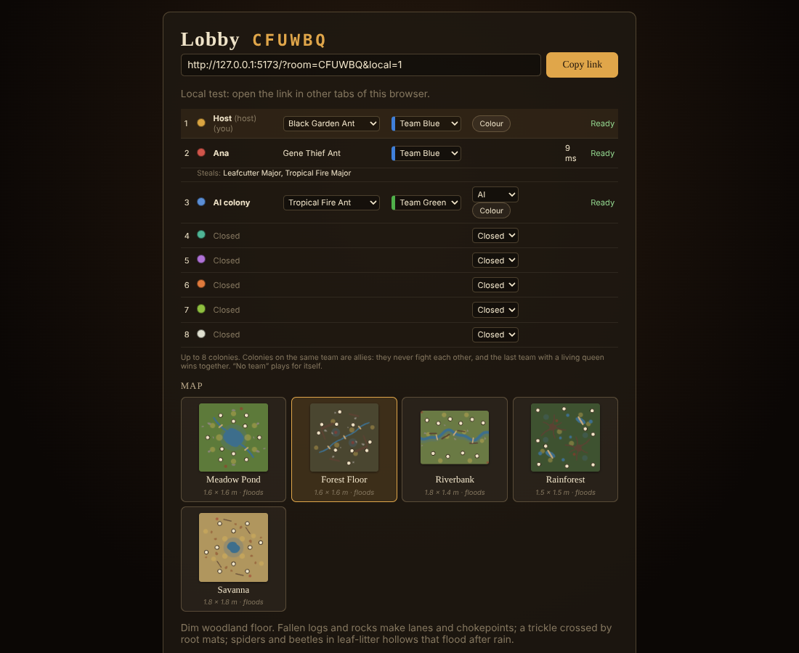
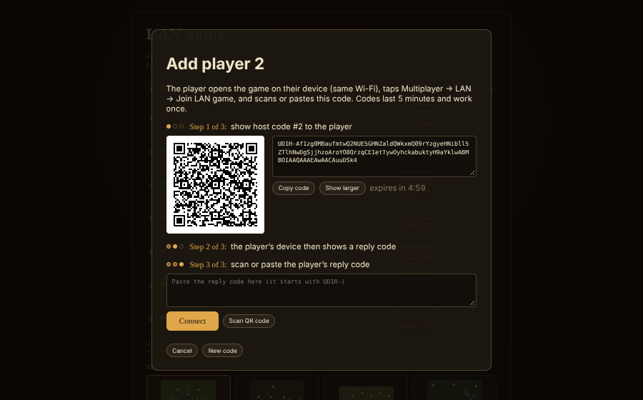
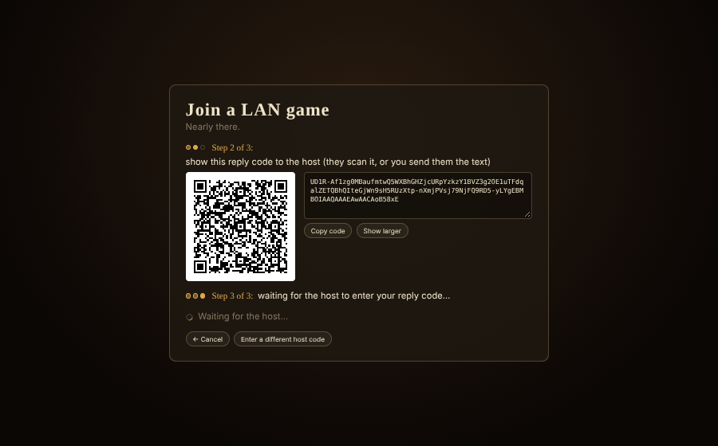
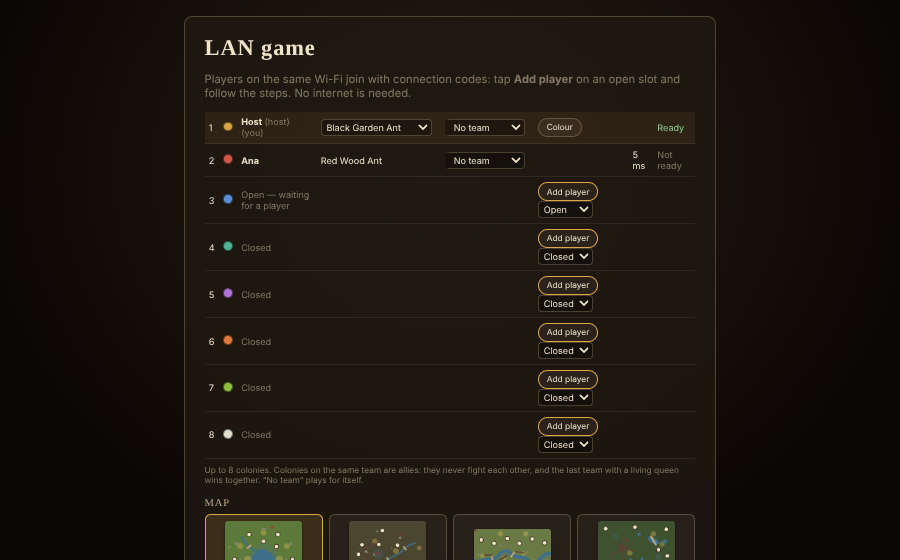
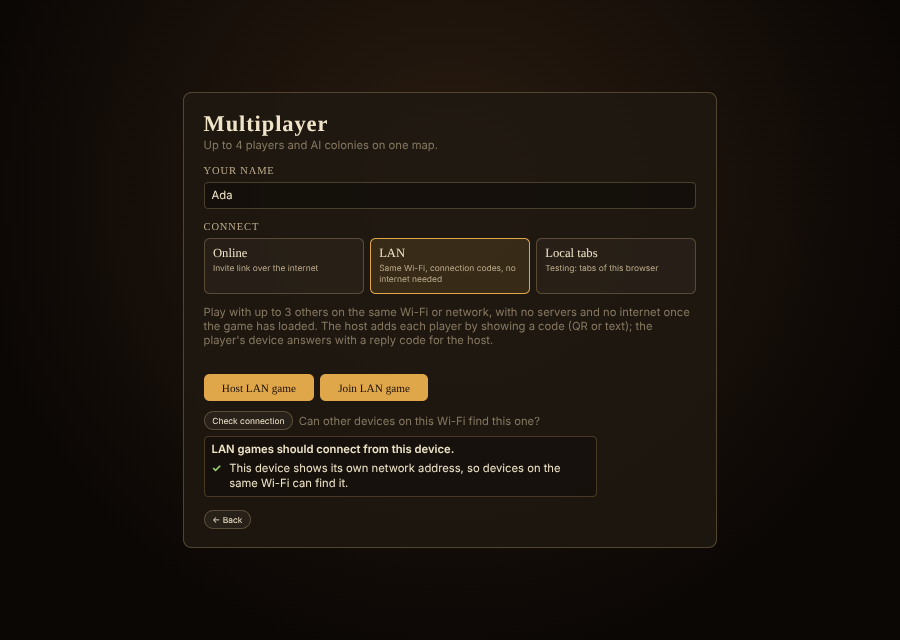

# Underground Dominion

A 3D ant-colony real-time strategy game in the spirit of *Empires of the Undergrowth*, built with TypeScript, Three.js and Vite. Everything is procedural: terrain, nests, ants, creatures, sounds and UI art. Species and behaviour follow real ant biology; the design document is [DESIGN.md](DESIGN.md), progress notes are in [PROGRESS.md](PROGRESS.md), and the current revision plan is [CHANGE_PLAN.md](CHANGE_PLAN.md).

## Running

```bash
npm install
npx vite            # dev server on http://localhost:5173
npx vite build      # production build in dist/
```

- `?play=1` skips the start menu. Further options: `&species=lasius|formica|atta|solenopsis|eciton|plagiaria|nasutitermes|rhynchotermes|hell|aurimyrmex|termant`, `&rival=<species>`, `&seed=N`, `&q=low|medium|high`. `&mode=mission&mission=meadow|forest` starts a mission, `&mode=sandbox` the sandbox. `&mode=arena&teams=2|3|4` opens the battle arena (`&style=meadow|forest|sandy`, default formicarium).
- `?areas=1` builds the five-area test level: your nest, an enemy nest, an allied nest, a cave and a beetle den.
- `?scene=antlab&ants=fire_minor,fire_major&cam=side|top|front|34&scales=1,1` is a model viewer (`&gold=1&exh=1` Saiy-Ant surge, `&mglow=0..1` the Blaster's mouth glow, `&mopen=0..1` hell-ant jaws, `&glue=1` termite glue on an ant; termites: `ants=termite_nasute&tstate=5&ramp=1&fire=1`; sickle-jaws: `ants=termite_rhy_soldier&tstate=14&statet=0.4` (lunge), `tstate=16` (threat); per-ant lists `poses=10,11,12,13&mopens=&hpitches=`, `swell=0..1` (an army-ant queen's physogastry), `prey=1` (a load under a porter-pose ant), `tints=1,2` (a Termant stolen caste, the neotenic queen)).

## Modes

The title screen has **Story**, **Single-player** and **Multiplayer**.

- **Story — *The Termants*** (chapter 1): a storm washes a Termant queen ashore on Wayfarer Island. On the
  island map pick a level, a difficulty (Easy, Normal, Hard, Brutal) and the stolen castes to bring (one slot); steal
  each species' caste from its dead and keep it by winning. Four levels in order: *The Garden Below* (black garden ants:
  steal the Black Garden Ant Soldier), *The Long Nights* (survive three nights of the island's night hunters; on the last
  a red-knee tarantula digs into your nest), *Fire on the Banks* (tropical fire ants: steal the Tropical Fire Ant Major)
  and *The Spider Mother* (a wolf spider titan in three phases; win the trait Spiderling Venom: your ants' bites carry a
  little venom in every story level). Each level has its own map with terraces and ramps, narration by a field
  scientist, short skippable camera shots (Esc), three medals (time or food stored, losses, a bonus objective) and a
  field-journal page. Progress is kept in this browser.

- **Single-player**, at your own pace, in four tabs: **Missions** (two story missions, *A Meadow Kingdom* and *The Forest Floor*, with a narrator, staged goals and a boss finale), **Skirmish** (you against 1–9 AI colonies on one of five authored maps — Meadow Pond, Forest Floor, Riverbank, Rainforest, Savanna — in teams; win when every rival queen falls), **Sandbox** (no rules: place any creature or boss, fill the stores, infinite food, wild creatures on or off) and **Battle Arena** (2–4 teams — Red, Blue, Green, Gold: drop any ants, termites or creatures in, 1–50 at a time and level I–III, round a team's corner or where you click; each team charges, holds or stands passive; the last team standing wins the round. Slow motion down to ¼×, climb rails and hitboxes make climbing easy to watch: put a passive stag beetle in the middle and send ants at it). You can pause (P) and change speed (− / =).
- **Maps:** **Meadow Pond**, the first hand-made map (1.6 × 1.6 m: a lily pond, two streams with stepping stones, rocks, ten colony sites), or a random map in one of four styles. Four more hand-made maps are on the way.
- **Multiplayer**: 2–4 players plus optional AI colonies on one map; last queen standing wins. A match always runs at 1× and **cannot be paused**. Opening a menu or photo mode does not stop it.

### Multiplayer and invite links
1. **Create game** gives you a six-letter room code and an invite link (`…/?room=ABCDEF`). Press **Copy link** and send it.
2. Friends open the link and land in the lobby. Each player picks a name, species, colour and team, then clicks **Ready**. A **Mimic Ant** player also picks the castes it steals (any of the 24 borrowable castes, the termite soldiers included; each needs its own room tile).
3. The host can set each of the eight slots to Open, Closed or AI (and pick an AI's species, team and, for a Mimic Ant AI, its castes), move anyone to another team, pick the map from the map cards (everyone sees the choice), and set the seed, food, floods, whether titans raid nests (on by default: now and then a titan digs one of a colony's holes wider and walks into its nest breaking the ground it touches) and population cap.
   - **Teams:** Red, Blue, Green, Gold or no team. Teammates never fight each other, start on neighbouring colony sites (the map cards show each team's sites), help each other when an AI is on the team, and win together when theirs is the last team with a living queen. Everyone on one team cannot start.

   
4. The host starts the match once everyone is ready.

How it works:
- Every player's computer runs the same deterministic simulation (lockstep at 20 ticks a second). Only commands travel over the network, a few bytes each. The input delay adapts to the connection, from 1 tick on a LAN to 8 ticks (50–400 ms). Your markers, tiles and group moves appear at once with a shimmer until the command runs.
- If a player stops responding, everyone sees "Waiting for …". After 30 s the AI takes over that colony; the host can also do this at once with **Drop now**.
- A player who reloads the page or loses the connection rejoins through the same link. The host sends the current state, the client catches up, and the colony is theirs again.
- Every 100 ticks the players compare a hash of the whole game state. If they ever differ, the match stops with "Desync detected" and offers a report to download. It never carries on out of step.
- **Local test without the internet:** the *Local tabs* tab of the Multiplayer menu. The players are then tabs of the same browser on one computer (`?room=ABCDEF&local=1`). For several devices without the internet, see LAN play below.
- **Invite links need the deployed site.** A dev server on `localhost` cannot be reached by friends on other networks. Players connect through the free public PeerJS signalling server and then directly (WebRTC).
  - Where a direct connection is impossible (phone data, strict routers, VPNs, school or work networks), the game's messages go through a TURN relay: by default the free public [Open Relay Project](https://www.metered.ca/tools/openrelay/) server (UDP 80, TCP and TLS 443). To use your own relay (more reliable), set it at build time: `VITE_TURN_URL=turn:host:3478 VITE_TURN_USER=… VITE_TURN_PASS=…`. The GitHub Pages build reads these from the repository variables `TURN_URL`, `TURN_USER` and `TURN_PASS` (Settings → Secrets and variables → Actions → Variables). Anything in a build is visible to players, so use a relay account meant for browsers.
  - Your own PeerJS server: `VITE_PEER_HOST`, `VITE_PEER_PORT`, `VITE_PEER_PATH`, `VITE_PEER_SECURE`.

### How to play on LAN (no internet)
For 2–4 devices on the same Wi-Fi or network (laptops, tablets, phones in landscape), with no servers at all.
1. Everyone opens the game's website, https://chibisc.github.io/WIP/ (once it has loaded, no internet is needed). The copy published as a Claude artifact cannot make network connections between players: its frame blocks WebRTC, so play multiplayer from the website.
2. The host: **Multiplayer → LAN → Host LAN game**, then **Add player** on an open slot. A host code appears as a QR code and as text.

   
3. The other player: **Multiplayer → LAN → Join LAN game**, then **Scan QR code** (camera) or paste the text. Their device shows a reply code.

   
4. The host scans or pastes the reply code. The player appears in the lobby. Repeat for each player, then ready up and start as online.

   

If a player drops out during a match, the host taps **Players → Reconnect** and they exchange codes again; the player's colony is theirs again once the game has caught up. Codes last 5 minutes and work once. Where the page cannot use the camera, paste the text instead (a phone's camera app can read the QR code as text to copy). On an iPhone or iPad (any browser) and in Safari, the first Host or Join asks to allow the microphone once: WebKit only shows a page its own Wi-Fi address after that. Nothing is recorded.

### When players cannot connect
- **Turn off any VPN on every device** and reload the page. VPNs block devices on the same Wi-Fi from seeing each other, and many (apps and browser extensions with "WebRTC leak protection") block the connections online play uses.
- **Multiplayer → Check connection** (on the Online or LAN tab) says what works from that device: the matchmaking server, a direct route, the relay, and the device's own address. On LAN it can also let the browser use the device's real address instead of a `.local` name (it asks for the microphone once).
- LAN: guest networks and routers with "client isolation" stop devices seeing each other; a phone hotspot that every device joins usually works.

  

## Deploying

```bash
npm run build          # type-checks, then writes the static site to dist/
```

`dist/` is a static site: upload it anywhere.
- **Netlify:** drag `dist/` onto the dashboard, or connect the repository with build command `npm run build` and publish directory `dist`. `public/_headers` makes the site cross-origin isolated (`COOP: same-origin`, `COEP: credentialless`). The simulation worker can then share its per-tick entity data through `SharedArrayBuffer`s instead of transferring new buffers each tick.
- **GitHub Pages** (no custom headers), itch.io and any other static host also work. Without isolation the worker transfers its buffers each tick, which also costs no copy.
- The build uses relative paths (`base: './'`), so it works from a sub-folder (`user.github.io/game/`).

## Playing

You start with a queen, her seven-tile chamber and three small **nanitic** workers. The queen never moves or fights: she makes eggs and takes the damage. **Home workers** pull each egg from the tip of her abdomen and carry it to an empty brood tile, where the larva grows while there is food and hatches into that tile's caste. She always has an egg ready: every empty brood tile gets a worker at once.

**Food comes from markers.** Home workers stay in the nest and do its jobs, as in *Empires of the Undergrowth*. To gather food, place a marker on it and drag a group card onto that marker's column (early on, the queen's own group). Workers collect around their marker and carry the food home, each taking its own load (its caste's carry, ×1.25 at level II and ×1.5 at level III); soldiers hold the spot and fight. Dead ants are food for their enemies for 2 s (dead termites for 7 s), then sink into the ground.

**Marker orders.** Under each column in the marker panel (the five markers and Home, for the nest-job groups), three toggles give its groups standing orders: **no attacking** (they go after no enemy and only bite back when bitten), **no gathering** (they pick nothing up and hold the marker in a guard line) and **no climbing** (they fight big creatures from the ground). A red, struck-through icon means the order is on.

**Fighting** (EotU-style, combat v2). Fighters wait at a marker in a **guard line** — rows across it, a body's room apart, facing the nearest enemy (or away from the nest). When armies meet, the clash breaks into many small, separate duels with ground between them: only a few ants can fight one target at once (room round its body: three on a worker its own size, more on bigger targets), each attacker stops at mandible reach facing its foe (no bodies piling on top of each other), and the rest go for a foe nobody has yet, walk round to a free place on the far side, or wait in a loose ring and step in when a place frees. Fighting nestmates keep a little room from each other. Every attack is **anchored** (combat v2.1): a biting, stinging or spraying ant stands its ground — nobody pushes it, it does not slide after its foe, and it turns toward its foe only as it winds up a bite; creatures stand still through each bite's wind-up, the bite and the recovery, and their sweeps and lunges land where they were telegraphed. Creatures reach as far as their jaws, fangs or forelegs really do from the edge of their body (a mantis strikes a third of its length past its head, a spider grabs with its front legs, a stag beetle pinches with its antler tips), so a creature fights the ants within reach from where it stands and walks only when none is in reach. An ant that cannot get through **backs off and goes round** the fight to a free place instead of shoving, so a swarm wraps round a creature rather than pressing into it from one side; ants walking to a marker steer round fights on the way. To make them gang up on one target, put a marker on it. Small ants walk and fight **under taller units** (combat v2.2): every unit's height and the room under its body come from its model, so an Atta minim runs straight under the medias and majors and an army-ant worker under the soldiers, and small ants fight a tall foe from under its body; a big ant bracing to bite lowers its head, a porter carrying prey has nothing under it. An ant hidden under a taller one is outlined through it in its team's colour; click the same spot again to pick the one underneath. **Kings** (termites, Termants) cannot be attacked, bite weakly and die with their queen.

**Large creatures** remember who hurts them most and turn on them; their stomps, sweeps and clamps are aimed at the thickest crowd and shown on the ground before they land, and they back off when surrounded and hurt. Wolf spiders drag a single ant out of a group.

**Mounting** (as in EotU). Ants and termites can **mount large creatures and titans**: an ant runs up a leg to a weak point (the neck, the waist, a leg joint, the top of the abdomen), rides there for 8 s biting (untouchable all the while; fire ants also sting), climbs down and can go again 6 s later. Small ants mount large and huge creatures, big castes only titans, and shooters never (the caste card says which). A titan takes up to 12 riders and a large creature up to 8 (fewer on small ones); no more than 30 % of the ants fighting a creature ride it, so a ground force must keep fighting below. With half its riders on, the creature takes 25 % more damage (✦ on its health bar, which also shows riders / cap). Titans telegraph a shake-off that throws their riders down; a creature that leaves the map takes its riders with it.

**Entrances.** Each nest has one wide entrance: seven hexes at the edge of the nest whose floor slopes up to the surface, lit by a shaft of daylight. Above it, the colony's anthill has three holes, all leading into it, always open. The anthill is built the way that species really builds it (a low crater of crumbly soil for black garden ants, a thatched dome for wood ants, a carton nest with covered galleries for nasute termites, and so on). Ants leave by the hole facing where they are going and come home by the nearest; each hole lets about 10 ants through a second, so a crowd spreads over all three. Digging never makes another entrance. A fallen colony's holes cave in over a minute.

**Tunnels between nests.** Every nest lies in one shared underground, ringed by rock nothing can dig. Set routes of diggable soil run through that rock from a brownish patch of loosened soil on your nest's edge (a gate) to the matching gate of a neighbour's nest (every neighbour on small maps, the nearest few on big ones). Use the Dig tool on a gate and your workers dig the route — one route at a time (another gate pauses the first; its progress stays) — about 3–5 minutes for a normal crew, half that if the other side digs toward you too. As your diggers near the far gate you get hints of what waits beyond it; the defender hears digging behind the wall, sees a red ! on its gate and gets an alert. Once the route opens it stays open for good: ants walk through it between the nests (markers in the other nest send groups through; scrolling past the halfway point switches the view), and in an enemy nest you see only what your ants can see. Allies can link their nests the same way, and AI colonies tunnel, guard their gates and link up too. Coming in by the surface entrance works as before.

**The trees.** In matches with a tree-dwelling colony (none yet), the sandbox's **Trees: On** in its setup (or the **Trees on** button in the game), or the dev URL `?trees=1`, a third layer lies over the ground: the **canopy** — every tree's crown of branches, twigs and leaves, joined to the others by boughs reaching out, one map for the whole match. The tall **TREES** bar to the right of the ground map goes up into it (and back down: it reads GROUND up there); the ground map then shows the canopy. Ants get up by **climbing a trunk**: each tree's trunk is a wall on the ground with a few pale rings at its foot, the climb points; a marker placed on a branch sends a group to the nearest climb point of the right crown, up the bark on their feet, bodies along the trunk (a few seconds, a few ants a second per climb point — trunks are chokepoints) and along the branches, and a marker on the ground brings them down. Ants walk only on wood and leaves (narrow twigs let a few through abreast), gather the food lying on the branches, fight there and hold markers there; wild creatures that climb come up too. Nothing walks off a branch: only a fling knocks an ant off, and then it falls to the ground straight below, lands dazed and goes on. Four to six set branches per map are **nest sites** for future tree species (a leaf cluster, a hollow, a sheltered fork), marked faintly and empty in normal games; a tree nest's hole lies on its branch and its tab works like an underground nest's. Without the layer nothing of it exists and nothing costs. Creature lairs are gone from skirmish and sandbox maps: wild creatures wander in from the map's edges (story levels keep their lairs).

**Underground areas.** The numbered tabs on top of the minimaps are the level's underground areas: 1 is your nest, the others are enemy and allied nests and neutral caves. A tab opens only while your ants (or allies) are inside. To go in, drop a marker on any of the area's entrance holes on the surface (the surface map shows each anthill as a crown in its colour, with its number and a dot on each hole). Once your ants are inside, open the tab and place markers within the area. Ants cut off from their queen weaken and die within 30 s.

### Build panel tools
| Tool | What it does |
|---|---|
| Dig (G) | Mark soil hexes; workers dig them (6 points each; 2 workers per hex). Click a marked hex again to cancel. |
| Brood tiles | One per caste. Placed on dug floor as a ghost, its food taken at once (you can't place what you can't afford; cancelling gives it back); a worker then builds it. Touching tiles of one kind form a chamber, which is one group card. |
| Food Storage | Holds 10 / 40 / 100 food by level. |
| Highway | Packed-earth floor: +10 / 20 / 25 % speed by level (other built tiles slow ants by 35 %). |
| Species tiles | Fungus garden (leafcutters), root-aphid pasture (black garden ants), thatch (wood ants), sun-warmed brood mound (fire ants), carton wall (Termants: paid from their one food store, blocks enemies until chewed through). |
| Upgrade (U) | Mark a tile for upgrade. Needs 6 points for level 2 and 12 for level 3 from its neighbours (same kind: its level; soil: 1; highway: its level). Costs the build cost. Hover shows each neighbour's points. |
| Delete (Delete) | Downgrades one level first; at level 1 removes the tile (its ant dies) and refunds two-thirds of the cost as seeds, which workers carry to storage. |

### Camera
| Input | Action |
|---|---|
| WASD / arrow keys / screen edges / middle-drag | Pan (left-drag on empty ground too) |
| Wheel · Z / X | Zoom (tilts lower up close) |
| Right-drag · Q / E | Rotate and tilt |
| C | Reset the camera |
| Space | Jump to the selected marker, switching maps if needed |
| F9 · Shift+F9 | Photo mode (pauses, hides the UI) · free-flying camera |

### Hotkeys
| Key | Action |
|---|---|
| 1 – 5 | Select marker I–V to place (then click the ground) |
| Right-click a marker | Lift it |
| Tab | Surface ⇄ last underground area |
| Shift + 1 – 6 / area tabs | Show underground area 1–6 |
| F3 | Debug overlay and profiler: frame rate, frame time (average, p95, worst), the main thread's time by part, GPU time where the browser measures it, draw calls, triangles, shader programs, textures, the heap and an estimate of GPU memory, the hitch log (every frame over 33 ms and what happened in it), the simulation's tick, the network and each player's tick and frame time; draws the creatures' climbing points, rails, weak points and mount slots, free and taken |
| Enter | Chat (multiplayer) |
| N | Next open underground area |
| G · U · Delete | Dig · Upgrade · Delete tools |
| P | Pause |
| − / = | Slower / faster |
| T | Pheromone trail overlay |
| R | Recall every group home |
| O | Follow the inspected ant |
| Esc | Cancel the tool / stop following / menu |
| Shift + 1 – 4 (battle arena) | Pick team Red, Blue, Green or Gold |

### Phones and tablets (iPhone, iPad, Android)
| Touch | Action |
|---|---|
| Drag one finger | Pan (with the Dig or Build tools: paint hexes) |
| Tap | Click: pick, place a marker, plan a tile |
| Long press | Right-click: lift a marker, cancel the tool. On a button: its tooltip |
| Pinch · twist two fingers | Zoom · rotate (two fingers also pan) |
| Drag three fingers up or down | Tilt |
| ✕ button (top centre) | Cancel the tool / stop following an ant |

Play phones in landscape (in portrait the game asks you to turn the phone). On phones, and on tablets held upright, the interface switches to a compact layout with bigger buttons: the maps fold behind the map button beside the area tabs, the build panel behind **Build**, and the marker panel starts folded to its markers (the arrow button unfolds the group cards). Auto graphics quality starts at Medium on touch devices, and the frame rate is held at 60 there (a 120 Hz screen at 60 runs cooler). On iPhone, sound follows the ring/silent switch.

The pause menu has graphics quality, frame rate (match the screen, 60 or 30), interface size, edge scrolling and the sandbox setting **Reveal all underground areas**. Auto quality first lowers the render resolution a little (never below 75 %, with a light sharpen) and only then the preset.

### Benchmark
Menu → Graphics → **Run the benchmark** (or open the game with `?bench=1`; `&bonly=gpu` runs one scene) runs eight fixed scenes for about four minutes: scripted clicks, orders, digging, building and camera moves (how quickly the game answers), what each effect costs (the big fight at a fixed camera with ambient occlusion, bloom, depth of field, all post effects, shadows, double resolution, the ants and the grass turned off one at a time), switching surface ↔ underground ten times, a big fight, a full nest, a story night, the arena at 600 units and a multiplayer-sized world. It ends with a report to copy and send (frame times, hitches and their causes, the switch frames, draw calls, memory). See `docs/performance.md`.

## Species
| Species | Castes |
|---|---|
| Black garden ant (*Lasius niger*) | worker, soldier |
| Red wood ant (*Formica rufa*) | worker, tank soldier, mortar sprayer, rapid sprayer |
| Tropical fire ant (*Solenopsis geminata*) | worker, soldier, major |
| Leafcutter ant (*Atta cephalotes*) | minim, media, soldier, major |
| Army ant (*Eciton burchellii*) | worker, porter (carries prey under its body, leads team carries), media (escorts the porters), soldier (hooked jaws; guards the raid trail once there are 3 or more), wingless queen. Raids sweep the marker area as a pulsing swarm front; three-lane trails, living bridges over water, pothole plugs. They eat only **insects and corpses**. |
| Mimic Ant (*Formica plagiaria*, fictional) | its own worker plus castes borrowed from any species, termite soldiers included |
| Nasute Termites (*Nasutitermes corniger*) — termites, not ants | worker (two sizes), nasute soldier (ramping glue stream), major soldier (charge, glue hold, drumming alarm); a king guards the royal chamber. They eat only **wood**. |
| Hell ants (Haidomyrmecinae, extinct) | worker (snaps small prey up against its horn and pins it), soldier (impales it on its paddle) |
| Saiy-Ants (*Aurimyrmex fulgurans*, fictional) | worker, soldier: bites only (no acid); Blaster: glowing orbs from the mouth, and in gold every fifth shot a 3 s beam; flash gold in a fight for 10 s (or by the group's **Gold Surge** button) for more speed and damage, then tire |
| Sickle-Jaw Termites (*Rhynchotermes perarmatus*) — termites | worker (bigger than the soldier), sickle-jaw soldier (lunges, hooks an enemy up to twice its size in its crossed mandibles and holds it until one of them dies, squirting acid that ramps 2 → 18 HP/s; bigger enemies get bitten and squirted while free); one queen and a king. They eat **leaf litter** and wood. |
| Termants (*Chimaeromyrmex termitoides*, fictional ant–termite hybrid) | worker (wood eater, formic acid), soldier (glue burst: slows the target and doubles formic-acid damage on it), a king beside the queen. Eating enemy corpses gives gene samples; enough samples and that species' caste can be raised as their own (up to 3, **Genome** tab). Carton walls from wood. One queen: no replacement queens. |

Every worker caste costs 10 food to build; soldiers and majors cost more, and hatch costs scale with strength (`src/sim/balance.ts`).

## Tests and tools
```bash
npm test                                                            # determinism lint + simulation tests + headless multiplayer tests
npx vite-node tests/run-all.ts                                      # simulation, commands, worker frames, creature models
npx vite-node tests/net.ts                                          # lockstep: sync, desync, drop/rejoin, 150 ms, surrender
npx vite-node tests/species.ts                                      # Nasute Termites, hell ants, Saiy-Ants (ramp values, snap, surge, AI, 10-min determinism)
npx vite-node tests/royals.ts                                       # termite royals (kit v2.1): sizes, chamber fit, king beside her, eggs from her tip
npx vite-node tests/sickle.ts                                       # Sickle-Jaw Termites: the ramp, holds, rescue, one soldier per victim, size limit, miss, alarm, king, AI, litter, determinism
npx vite-node tests/eciton.ts                                       # army ants: castes and old ids, diet, swarm front, lanes, porters, Soldier posts, bridges, plugs, hook, pinning, models unchanged, determinism
npx vite-node tests/story.ts                                        # story mode and layered ground: rename, banks and ramps, both story maps, setup by difficulty and loadout, the director's scenes, every objective type, bonus and medals, a caste missed, the campaign save, determinism
npx vite-node tests/storyCh1.ts                                     # chapter 1 as four levels: order and save rule, the new maps, the nights' clock, hunters and tarantula, the Spider Mother's phases, Spiderling Venom, determinism
npx vite-node tools/playtest-story.ts -- garden normal 50 7          # a story level played headless by the colony AI plus a scripted player (level: garden, longNights, fireBanks, spiderMother; difficulty, minutes, seed, loadout; STRATEGY=hole: defend at the hole a titan digs)
npx vite-node tests/titans.ts                                       # titans digging into nests (hole times, the damage-rate slow, checkpoints, memory, breach, raids)
npx vite-node tests/trees.ts                                        # the Trees layer: off by default, the canopy map, climbing with the hold, markers on branches and across crowns, the fall, the sandbox toggle, saves, a tree nest
npx vite-node tools/trees-check.ts -- 3                               # every map's canopy: trees, climb points, sites, food, one joined canopy, every site and food reachable (seed)
# dev: ?trees=1 (with &play=1&mode=sandbox&map=…): the layer on with a placeholder tree colony; &view=trees opens the canopy; tests/browser/trees.py renders the stills (docs/trees/shots/)
npx vite-node tests/tunnels.ts                                      # the shared underground: rock margins, set tunnel routes, digging from both ends, opening, crossing, warnings, fog, old saves, determinism
npx vite-node tools/tunnel-check.ts -- 2                              # routes on every map for 2–10 colonies: three wide, rock-walled, gates on the edge, no crossings (and a sketch)
npx vite-node tools/tunnel-dig-probe.ts -- 6 3                       # a crew digging a route toward a rival: the warning, the rim, the opening, the breach, a group walking through (workers, seed)
npx vite-node tools/tunnel-ai-probe.ts -- 3 20 5                      # AI colonies tunnelling, guarding gates and linking allied nests (level, minutes, seed)
# dev: ?tunnel=dig|warn|open|in|enemy|ally (with &play=1&rival=lasius…): a tunnel scene from that stage; tests/browser/tunnels.py renders the stills (docs/underground/tunnels/)
npx vite-node tools/titan-holes.ts -- 5                              # time to open a hole per titan: undefended / 20 / 80 defenders / riders (SPECIES=lasius; docs/creatures/titans.md)
npx vite-node tools/titan-raid-probe.ts -- longNights hole normal    # a story titan's dig-in tick by tick (setups none/hole/attack/riders/block/burrow; LINES=1)
npx vite-node tools/caste-table.ts                                   # every caste's numbers (-- creatures: the creatures')
npx vite-node tools/balance-matrix.ts -- refs 300                     # equal-food fights v a reference caste (refw / refs / refm / creatures; docs/balance/castes.md)
npx vite-node tools/balance-tune.ts -- lasius_soldier 300 atta_soldier # the stat scale at which a caste ties the reference
# dev: ?story=1 the island map; ?story=garden&stage=2&ants=30 a level from any stage (with extra ants); &titan=1 straight to the stage's titan digging in (longNights stage 2, spiderMother stage 1); &nocine=1 no camera shots; &retry=1 a restart (no opening flight); &traits=spiderlingVenom (or &traits= for none) instead of the campaign's
npx vite-node tests/termants.ts                                     # Termants: genes from enemy corpses only, unlock, cost ×1.5, max 3, forget, glue and acid, wood, carton walls, one queen and no replacement, AI, determinism
npx vite-node tests/animation.ts                                    # animation pass (render only): planted feet, variety, idles, hits, deaths, flings
npx vite-node tools/anim-cost.ts -- 1040                            # the animation controller's CPU cost per frame for a crowd
# animation lab (dev server): ?scene=animlab&clip=atk1 — attacks atk0–2, major0–1, flag, hits, deaths (by cause), fling, walk, stag_*;
# &cdist= / &ctx= / &ctz= move the camera; tests/browser/anim_clips.py records clips (docs/realism/combat/)
# any species in the lab: &ant=<morph>&big=<morph> (e.g. &ant=atta_media&big=atta_major); clip=spray (Formica's three sprayers), troph (Lasius)
# realism sheets and clips per species: docs/realism/<species>/ (render only); the overnight report: docs/realism/OVERNIGHT-REPORT.md
# hell ants and nasute termites (realism rework 2026-11-02): clip=termites (the nasute castes' states), clip=royals; &ant=hell_worker for the snap
# ant lab extras: &light= now lights termites too; &contact=1 contact shadows; &amber=1 a unit in a block of amber (lab only, never in the game)
python3 tests/browser/hell_nasute_realism.py docs/realism/hell-nasute/renders   # lab renders per unit, view and light (UNITS, VIEWS, LIGHTS; with_server.sh)
npx vite-node tests/aiAllies.ts                                     # AI with allies: team placement on the five maps, 7/19-hex one-type chambers, stores, highways, upgrades, the ally brain (help, guard, recall, lost causes, call for help), joint raids, determinism
npx vite-node tests/fights.ts                                       # guard line, room in a fight, foes shared out, creatures apart, calm after a fight, marker orders (no attacking / gathering / climbing)
npx vite-node tools/postfight.ts -- ant:lasius_soldier 20           # what fighters do once their foes are dead (zigzags, stop-start, states)
npx vite-node tools/fightspread.ts -- ant:lasius_soldier 24 ant:formica_soldier 24   # how spread out a melee is, second by second
npx vite-node tests/arena.ts                                        # battle arena: 2/3/4 teams, no economy, spawning, ants v ants, creatures v creatures, own team spared, stances, climbing a passive titan, clearing, replay and restore, 600-unit tick time
npx vite-node tools/termite-royal-data.ts                           # regenerate sim/termiteRoyalData.ts after a termite model kit change
npx vite-node tests/combat.ts                                       # no spinning, slots, separation, climbing, corpses, harvest, queens, king, eggs, AI nests
npx vite-node tests/combatV2.ts                                     # combat v2: spacing, stop at reach, slots by outline, reservation, overflow, duels, no snapping, repositioning, under-body, threat, aimed splashes, shake-off, mounting rules
npx vite-node tests/combatV21.ts                                    # combat v2.1: anchored attacks (no drift, facing locked, creatures still), splash fixed at the wind-up, back off and go round, no pushing anchored ants, duels, tunnels
npx vite-node tests/underpass.ts                                    # combat v2.2: heights data not stale, Atta/Eciton fits, walking under big teammates, poses (loaded porter, braced, dead), step-outs, from beneath, mixed squads, determinism
npx vite-node tools/height-data.ts                                  # regenerate sim/heightData.ts (heights, zoned belly clearance, feet) after any ant, termite or creature model change; `-- table` prints the table and who passes under whom
npx vite-node tools/drift-probe.ts -- [scene=all] [secs] [seed] [trace=0]   # what moves or turns attacking units, by system; shoving metrics
npx vite-node tools/fight-motion.ts -- [scene=all] [secs] [seed] [move|kill]   # how far creatures and ants walk while fighting, and why; grips lost; kill: real-health outcomes
npx vite-node tools/orbit-probe.ts -- [seed] [secs] [mine] [theirs]   # one side outnumbering the other: ants waiting or going round, idle while a foe has room, how far they wait and how much they walk
npx vite-node tools/duels.ts -- ant:lasius_worker 60 ant:fire_soldier 60 20   # how a 60 v 60 clash breaks into duels (clusters, overlap)
npx vite-node tools/spin-check.ts                                   # 50 v 50 spinning, 30 ants on a beetle, tunnel flow
npx vite-node tools/climb-stress.ts -- 40 400                       # 4 titans with full riders + a 400 v 400 clash: tick time with and without mounting
npx vite-node tools/chain-check.ts                                  # centipede / caterpillar bodies: neck and joint bends, body vs hitbox
npx vite-node tools/eciton-raid.ts -- 40 8 5 8 120 5 1               # army-ant raid numbers: front, pulses, lanes, porters, posts, bridge, plugs [puddle=1]
npx vite-node tools/morph-hash.ts -- check tests/data/morph-hashes.json   # ant model geometry unchanged (save <file> for a new baseline)
npx vite-node tools/climb-data.ts                                   # re-author climbing points, rails, weak points and mount slots from the creature models
npx vite-node tools/termite-income.ts -- 3 8                        # termite wood vs ant food income per worker-minute
npx vite-node tools/nasute-duel.ts                                  # one nasute vs one Lasius soldier, by seconds of head start
npm run test:determinism -- 20                                      # 20 min of a 4-colony game, run twice + once from a snapshot
npm run stress -- 400 60 100                                        # tick time: 4 colonies x 400 ants, 60 s, 100 creatures
tools/perf/bundle.sh . /tmp/sb.mjs && node /tmp/sb.mjs fight,nests 1000,2000 300 --systems --series   # the v3 stress scenes, bundled as the game ships: tick times, per system, slowest ticks
tools/perf/same.sh <main checkout | ref.json> fight,economy,nests,ten,titan,tunnel 500,1000,2000   # same results as main: the scenes' canonical hash lists (ALL SAME)
tools/perf/ab.sh <main checkout> fight 2000 300 3                    # main against this checkout, alternating runs, medians
npx esbuild tools/perf/unitsBench.ts --bundle --platform=node --format=esm --outfile=/tmp/u.mjs && node /tmp/u.mjs 200 300 default   # main thread: ant views, ant and creature renderers in a real fight
tests/browser/with_server.sh python3 tests/browser/scene_census.py  # what a scene holds: meshes, shadow casters, the biggest meshes by triangles (QUERY=…)
tests/browser/with_server.sh python3 tests/browser/ui_areas.py      # browser checks (Playwright); also ui_test.py, ui_test2.py, ui_dig.py, ui_camera.py
tests/browser/with_server.sh python3 tests/browser/mp_local.py      # 3 tabs + AI over BroadcastChannel: lobby, lockstep, chat, drop
tests/browser/with_server.sh python3 tests/browser/mp_finish.py     # 2 tabs: a match played to the end (surrender, results)
tests/browser/with_server.sh python3 tests/browser/story_titans_in.py # clips: the chapter 1 titans dig into the nest and walk it (ONLY=nights,spider ANTS=60 PARTS=surface,nest; docs/story/shots/titans_in/)
tests/browser/with_server.sh python3 tests/browser/worker.py        # also replay.py, stress.py, determinism.py
tests/browser/with_server.sh python3 tests/browser/species_renders.py  # new species in the lab; also species_battle.py, species_fx.py, attack_renders.py (the three melee attacks)
tests/browser/with_server.sh python3 tests/browser/combat_v2.py docs/combat/v2   # 60 v 60 clash shots (LABEL=before against the base), titan riders, shake-off, clip
tests/browser/with_server.sh python3 tests/browser/combat_v21.py docs/combat/v2.1   # combat v2.1 clips: drift in a clash and sprays, creature bites, a swarm on one beetle, six beetles (LABEL=before/after; COMBATDEBUG=1)
tests/browser/with_server.sh python3 tests/browser/melee_reach.py docs/combat/reach   # creature reach clips: a stag beetle, six ground beetles, a wolf spider, a tarantula and a mantis fighting ants (LABEL=before/after)
tests/browser/with_server.sh python3 tests/browser/underpass.py docs/combat/underpass   # under-pass clips: minims through a column of majors, Atta and Eciton mixed squads, small foes under a tall ant, outlines from above (LABEL=before/after; python3 tools/combat-v21-compare.py docs/combat/underpass for side by side)
python3 tools/combat-v2-sheets.py docs/combat/v2   # before / after sheets of those shots (and the renders to JPEG)
tests/browser/with_server.sh python3 tests/browser/climb_renders.py    # ants and termites climbing and riding creatures; also royals_renders.py (queens, king, eggs), termite_royals_v21.py (kit v2.1 royals: top/side/front/¾, far zoom, egg pull)
tests/browser/with_server.sh python3 tests/browser/sickle_renders.py  # Sickle-Jaw castes in the lab, a grab-and-squirt, a battle, a free squirt, the nest, leaf litter
tests/browser/with_server.sh python3 tests/browser/eciton_renders.py  # the five army-ant models and four poses, a raid at close and far zoom, posts, a bridge, a plug
tests/browser/with_server.sh python3 tests/browser/mobile.py        # iPhone / iPad emulation: compact layout, touch gestures, tap / long press, build drawer, maps, tooltips, arena
tests/browser/with_server.sh python3 tests/browser/termant_renders.py # the four Termant castes, the stolen-caste tint, stolen ants in the game, the queen and king, a carton wall, the Genome tab
npx vite-node tools/econ.ts -- lasius 24 7 1 1                      # AI economy and nest shape over N minutes [seed foodMul creaturesMul aiLevel]
npx vite-node tools/ecology.ts -- 20 1.5                            # creature balance: 4 colonies with wild creatures
npx vite-node tools/ecology-teams.ts -- 45 1 1 meadowPond 1 mixed   # a 2v2 of AI colonies [seed help(0/1) map creatures lineup(mixed/mirror/swap)]
npx vite-node tools/ally-probe.ts -- 120 14                         # the ally brain at work in a staged invasion [seconds band human bothInvaded seed developed]
npx vite-node tools/team-sites.ts                                   # every map's team placements (land routes, limits) → docs/maps/team-sites.md
tests/browser/with_server.sh python3 tests/browser/ai_nests.py      # AI nests from above at 10/30/45 min → docs/ai/chambers/ (and sheet.jpg)
tests/browser/with_server.sh python3 tests/browser/ai_help.py       # clip: an AI ally's soldiers come to your nest's rescue → docs/ai/allies_help.mp4
npx vite-node tools/battle.ts -- formica_soldier:2,formica_rapid:2 fire_minor:16 60
npx vite-node tools/equal.ts -- fire_major fire_soldier 150         # how many of each the same food buys
python3 tools/crsheet.py out.jpg "wolfSpider|wolf spider;mantis|mantis|state=11"   # creature model sheet (?scene=crlab)
```
Sound: every effect is a file made for this game, rendered offline from the physics of real insect sounds (`npm run audio:build`, Python with numpy, scipy, soundfile and pyloudnorm, plus ffmpeg; recordings in `audio-src/recordings/` replace a sound's takes). `?scene=sounds` is the sound board (every sound with its takes and a soundscape mixer). `docs/audio/` has the research notes, the sound list, the attributions and how the audio works.

Dev URLs: `?scene=crlab&kinds=stagBeetle,tarantula` (creature viewer: `state`, `st`, `walk`, `dead`, `eaten`, `cam`), `?play=1&spawn=wolfSpider:2,mantis` (creatures beside your entrance; add `&rival=formica&battle=lasius_soldier:14&climbdebug=1` to watch them climbed; `&hitboxes=1` draws every hitbox, as F3 does; `&combatdebug=1` the combat debug view: anchored, blocked, backing off, going round, slots), `?play=1&allies=lasius&rival=formica&developed=70` (an AI ally and a rival, everyone well grown; `&ailevel=0..3` the AI level), `?stress=1`, `?scene=determinism`, `?netsim=lat,jit,loss`, `?delay=N`, `?worker=0`.
