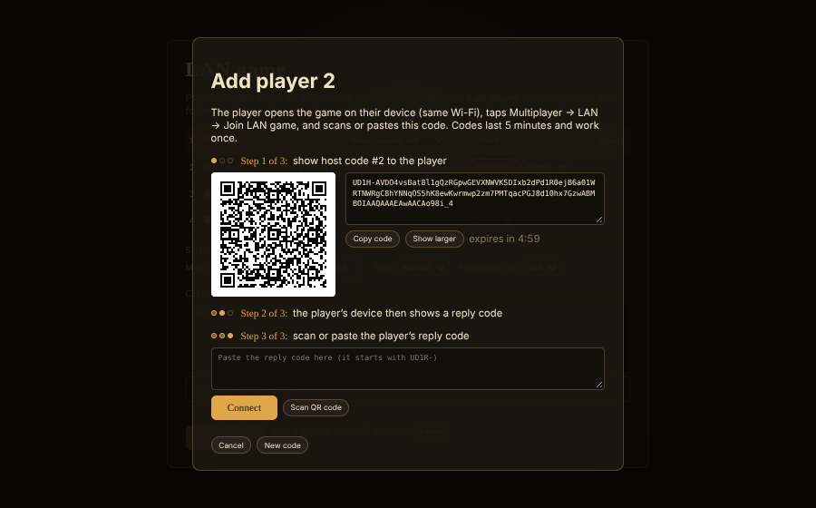
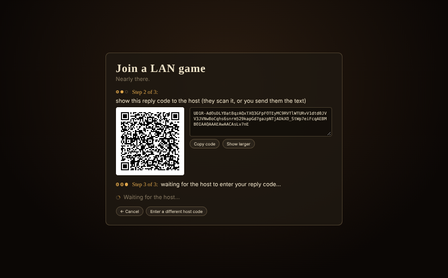
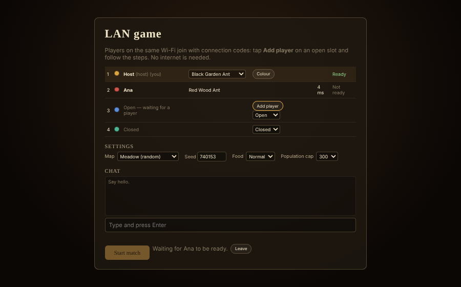

# Underground Dominion

A 3D ant-colony real-time strategy game in the spirit of *Empires of the Undergrowth*, built with TypeScript, Three.js and Vite. Everything is procedural: terrain, nests, ants, creatures, sounds and UI art. Species and behaviour follow real ant biology; the design document is [DESIGN.md](DESIGN.md), progress notes are in [PROGRESS.md](PROGRESS.md), and the current revision plan is [CHANGE_PLAN.md](CHANGE_PLAN.md).

## Running

```bash
npm install
npx vite            # dev server on http://localhost:5173
npx vite build      # production build in dist/
```

- `?play=1` skips the start menu. Further options: `&species=lasius|formica|atta|solenopsis|eciton|plagiaria|nasutitermes|rhynchotermes|hell|aurimyrmex|termant`, `&rival=<species>`, `&seed=N`, `&q=low|medium|high`. `&mode=mission&mission=meadow|forest` starts a mission, `&mode=sandbox` the sandbox. `&mode=arena&teams=2|3|4` opens the battle arena (`&style=meadow|forest|sandy`, default formicarium).
- `?areas=1` builds the five-area test level: your nest, an enemy nest, an allied nest, a cave and a beetle den.
- `?scene=antlab&ants=fire_minor,fire_major&cam=side|top|front|34&scales=1,1` is a model viewer (`&gold=1&exh=1` Saiy-Ant surge, `&mopen=0..1` hell-ant jaws, `&glue=1` termite glue on an ant; termites: `ants=termite_nasute&tstate=5&ramp=1&fire=1`; sickle-jaws: `ants=termite_rhy_soldier&tstate=14&statet=0.4` (lunge), `tstate=16` (threat); per-ant lists `poses=10,11,12,13&mopens=&hpitches=`, `swell=0..1` (an army-ant queen's physogastry), `prey=1` (a load under a porter-pose ant), `tints=1,2` (a Termant stolen caste, the neotenic queen)).

## Modes

The title screen has **Single-player** and **Multiplayer**.

- **Single-player**, at your own pace, in four tabs: **Missions** (two story missions, *A Meadow Kingdom* and *The Forest Floor*, with a narrator, staged goals and a boss finale), **Skirmish** (you against 1–6 AI colonies, in teams; win when every rival queen falls), **Sandbox** (no rules: place any creature or boss, fill the stores, infinite food, wild creatures on or off) and **Battle Arena** (2–4 teams — Red, Blue, Green, Gold: drop any ants, termites or creatures in, 1–50 at a time and level I–III, round a team's corner or where you click; each team charges, holds or stands passive; the last team standing wins the round. Slow motion down to ¼×, climb rails and hitboxes make climbing easy to watch: put a passive stag beetle in the middle and send ants at it). You can pause (P) and change speed (− / =).
- **Maps:** **Meadow Pond**, the first hand-made map (1.6 × 1.6 m: a lily pond, two streams with stepping stones, rocks, ten colony sites), or a random map in one of four styles. Four more hand-made maps are on the way.
- **Multiplayer**: 2–4 players plus optional AI colonies on one map; last queen standing wins. A match always runs at 1× and **cannot be paused**. Opening a menu or photo mode does not stop it.

### Multiplayer and invite links
1. **Create game** gives you a six-letter room code and an invite link (`…/?room=ABCDEF`). Press **Copy link** and send it.
2. Friends open the link and land in the lobby. Each player picks a name, species and colour, then clicks **Ready**.
3. The host can set each empty slot to Open, Closed or AI, and choose the map, seed, food and population cap.
4. The host starts the match once everyone is ready.

How it works:
- Every player's computer runs the same deterministic simulation (lockstep at 20 ticks a second). Only commands travel over the network, a few bytes each. The input delay adapts to the connection, from 2 to 8 ticks (100–400 ms). Your markers, tiles and group moves appear at once with a shimmer until the command runs.
- If a player stops responding, everyone sees "Waiting for …". After 30 s the AI takes over that colony; the host can also do this at once with **Drop now**.
- A player who reloads the page or loses the connection rejoins through the same link. The host sends the current state, the client catches up, and the colony is theirs again.
- Every 100 ticks the players compare a hash of the whole game state. If they ever differ, the match stops with "Desync detected" and offers a report to download. It never carries on out of step.
- **Local test without the internet:** the *Local tabs* tab of the Multiplayer menu. The players are then tabs of the same browser on one computer (`?room=ABCDEF&local=1`). For several devices without the internet, see LAN play below.
- **Invite links need the deployed site.** A dev server on `localhost` cannot be reached by friends on other networks. Players connect through the free public PeerJS signalling server and then directly (WebRTC).
  - Some strict firewalls and mobile networks block direct connections. For those, set a TURN relay at build time: `VITE_TURN_URL=turn:host:3478 VITE_TURN_USER=… VITE_TURN_PASS=…`.
  - Your own PeerJS server: `VITE_PEER_HOST`, `VITE_PEER_PORT`, `VITE_PEER_PATH`, `VITE_PEER_SECURE`.

### How to play on LAN (no internet)
For 2–4 devices on the same Wi-Fi or network (laptops, tablets, phones in landscape), with no servers at all.
1. Everyone opens the game's website, https://chibisc.github.io/ant-game/ (once it has loaded, no internet is needed). The copy published as a Claude artifact cannot make network connections between players: its frame blocks WebRTC, so play multiplayer from the website.
2. The host: **Multiplayer → LAN → Host LAN game**, then **Add player** on an open slot. A host code appears as a QR code and as text.

   
3. The other player: **Multiplayer → LAN → Join LAN game**, then **Scan QR code** (camera) or paste the text. Their device shows a reply code.

   
4. The host scans or pastes the reply code. The player appears in the lobby. Repeat for each player, then ready up and start as online.

   

If a player drops out during a match, the host taps **Players → Reconnect** and they exchange codes again; the player's colony is theirs again once the game has caught up. Codes last 5 minutes and work once. Where the page cannot use the camera, paste the text instead (a phone's camera app can read the QR code as text to copy). If devices cannot connect: guest networks and routers with "client isolation" stop devices seeing each other, and so can a VPN; a phone hotspot that every device joins usually works.

## Deploying

```bash
npm run build          # type-checks, then writes the static site to dist/
```

`dist/` is a static site: upload it anywhere.
- **Netlify:** drag `dist/` onto the dashboard, or connect the repository with build command `npm run build` and publish directory `dist`. `public/_headers` makes the site cross-origin isolated (`COOP: same-origin`, `COEP: credentialless`). The simulation worker can then share its per-tick entity data through `SharedArrayBuffer`s instead of transferring new buffers each tick.
- **GitHub Pages** (no custom headers), itch.io and any other static host also work. Without isolation the worker transfers its buffers each tick, which also costs no copy.
- The build uses relative paths (`base: './'`), so it works from a sub-folder (`user.github.io/game/`).

## Playing

You start with a queen, her seven-tile chamber and three small **nanitic** workers. The queen never moves or fights: she makes eggs and takes the damage. **Home workers** pull each egg from the tip of her abdomen and carry it to an empty brood tile, where the larva grows while there is food and hatches into that tile's caste. She always has an egg ready: every empty brood tile gets a worker at once.

**Food comes from markers.** Home workers stay in the nest and do its jobs, as in *Empires of the Undergrowth*. To gather food, place a marker on it and drag a group card onto that marker's column (early on, the queen's own group). Workers collect around their marker and carry the food home, each taking its own load (its caste's carry, ×1.25 at level II and ×1.5 at level III); soldiers hold the spot and fight. Dead ants are food for their enemies for 2 s (dead termites for 7 s), then sink into the ground.

**Marker orders.** Under each column in the marker panel (the five markers and Home, for the nest-job groups), three toggles give its groups standing orders: **no attacking** (they go after no enemy and only bite back when bitten), **no gathering** (they pick nothing up and hold the marker in a guard line) and **no climbing** (they fight big creatures from the ground). A red, struck-through icon means the order is on.

**Fighting.** Fighters wait at a marker in a **guard line** — rows across it, a body's room apart, facing the nearest enemy (or away from the nest). Attackers take a free slot round their target (its legs, or a place along a creature's body), hold it and face it; extras wait just outside and look for a foe nobody has taken yet. Fighters keep a body's room from each other, and creatures keep apart too. **Kings** (termites, Termants) cannot be attacked, bite weakly and die with their queen. **Large creatures and titans can be climbed:** an ant runs up a leg, rides the back for 8 s biting (untouchable all the while), climbs down and can climb again 6 s later. How many fit depends on sizes: a ground beetle takes three small workers, a stag beetle dozens, and bigger ants take more room. The small bar over a climbed creature shows room taken / room.

**Underground areas.** The numbered tabs on top of the minimaps are the level's underground areas: 1 is your nest, the others are enemy and allied nests and neutral caves. A tab opens only while your ants (or allies) are inside. To go in, drop a marker on the area's entrance on the surface (the surface map shows every entrance with its number and colour). Once your ants are inside, open the tab and place markers within the area. Ants cut off from their queen weaken and die within 30 s.

### Build panel tools
| Tool | What it does |
|---|---|
| Dig (G) | Mark soil hexes; workers dig them (6 points each; 2 workers per hex, 7 on an entrance dig). Click a marked hex again to cancel. |
| Brood tiles | One per caste. Placed on dug floor as a ghost; a worker builds it and the food is paid on completion. Touching tiles of one kind form a chamber, which is one group card. |
| Food Storage | Holds 10 / 40 / 100 food by level. |
| Highway | Packed-earth floor: +10 / 20 / 25 % speed by level (other built tiles slow ants by 35 %). |
| Species tiles | Fungus garden (leafcutters), root-aphid pasture (black garden ants), thatch (wood ants), sun-warmed brood mound (fire ants), carton wall (Termants: paid in wood, blocks enemies until chewed through). |
| Upgrade (U) | Mark a tile for upgrade. Needs 6 points for level 2 and 12 for level 3 from its neighbours (same kind: its level; soil: 1; highway: its level). Costs the build cost. Hover shows each neighbour's points. |
| Delete (Delete) | Downgrades one level first; at level 1 removes the tile (its ant dies) and refunds two-thirds of the cost as seeds, which workers carry to storage. |

### Camera
| Input | Action |
|---|---|
| WASD / arrow keys / screen edges / middle-drag | Pan (left-drag on empty ground too) |
| Wheel · Z / X | Zoom (tilts lower up close) |
| Right-drag · Q / E | Rotate and tilt |
| C | Reset the camera |
| Space | Jump to the selected marker, switching maps if needed |
| F9 · Shift+F9 | Photo mode (pauses, hides the UI) · free-flying camera |

### Hotkeys
| Key | Action |
|---|---|
| 1 – 5 | Select marker I–V to place (then click the ground) |
| Right-click a marker | Lift it |
| Tab | Surface ⇄ last underground area |
| Shift + 1 – 6 / area tabs | Show underground area 1–6 |
| F3 | Debug overlay (frame rate, simulation tick time, network; draws the creatures' climb rails and riding slots) |
| Enter | Chat (multiplayer) |
| N | Next open underground area |
| G · U · Delete | Dig · Upgrade · Delete tools |
| P | Pause |
| − / = | Slower / faster |
| T | Pheromone trail overlay |
| R | Recall every group home |
| O | Follow the inspected ant |
| Esc | Cancel the tool / stop following / menu |
| Shift + 1 – 4 (battle arena) | Pick team Red, Blue, Green or Gold |

### Phones and tablets (iPhone, iPad, Android)
| Touch | Action |
|---|---|
| Drag one finger | Pan (with the Dig or Build tools: paint hexes) |
| Tap | Click: pick, place a marker, plan a tile |
| Long press | Right-click: lift a marker, cancel the tool. On a button: its tooltip |
| Pinch · twist two fingers | Zoom · rotate (two fingers also pan) |
| Drag three fingers up or down | Tilt |
| ✕ button (top centre) | Cancel the tool / stop following an ant |

Play phones in landscape (in portrait the game asks you to turn the phone). On phones, and on tablets held upright, the interface switches to a compact layout with bigger buttons: the maps fold behind the map button beside the area tabs, the build panel behind **Build**, and the marker panel starts folded to its markers (the arrow button unfolds the group cards). Auto graphics quality starts at Medium on touch devices. On iPhone, sound follows the ring/silent switch.

The pause menu has graphics quality, interface size, edge scrolling and the sandbox setting **Reveal all underground areas**.

## Species
| Species | Castes |
|---|---|
| Black garden ant (*Lasius niger*) | worker, soldier |
| Red wood ant (*Formica rufa*) | worker, tank soldier, mortar sprayer, rapid sprayer |
| Tropical fire ant (*Solenopsis geminata*) | worker, soldier, major |
| Leafcutter ant (*Atta cephalotes*) | minim, media, soldier, major |
| Army ant (*Eciton burchellii*) | worker, porter (carries prey under its body, leads team carries), media (escorts the porters), soldier (hooked jaws; guards the raid trail once there are 3 or more), wingless queen. Raids sweep the marker area as a pulsing swarm front; three-lane trails, living bridges over water, pothole plugs. They eat only **insects and corpses**. |
| Gene Thief (*Formica plagiaria*, fictional) | its own worker plus castes borrowed from any species |
| Nasute Termites (*Nasutitermes corniger*) — termites, not ants | worker (two sizes), nasute soldier (ramping glue stream), major soldier (charge, glue hold, drumming alarm); a king guards the royal chamber. They eat only **wood**. |
| Hell ants (Haidomyrmecinae, extinct) | worker (snaps small prey up against its horn and pins it), soldier (impales it on its paddle) |
| Saiy-Ants (*Aurimyrmex fulgurans*, fictional) | worker, soldier: bites only (no acid); flash gold in a fight (or by the group's **Gold Surge** button) for more speed and damage, then tire |
| Sickle-Jaw Termites (*Rhynchotermes perarmatus*) — termites | worker (bigger than the soldier), sickle-jaw soldier (lunges, hooks an enemy up to twice its size in its crossed mandibles and holds it until one of them dies, squirting acid that ramps 2 → 18 HP/s; bigger enemies get bitten and squirted while free); one queen and a king. They eat **leaf litter** and wood. |
| Termants (*Chimaeromyrmex termitoides*, fictional ant–termite hybrid) | worker (wood eater, formic acid), soldier (glue burst: slows the target and doubles formic-acid damage on it), a king beside the queen. Eating enemy corpses gives gene samples; enough samples and that species' caste can be raised as their own (up to 3, **Genome** tab). Carton walls from wood. One queen: no replacement queens. |

Every worker caste costs 10 food to build; soldiers and majors cost more, and hatch costs scale with strength (`src/sim/balance.ts`).

## Tests and tools
```bash
npm test                                                            # determinism lint + simulation tests + headless multiplayer tests
npx vite-node tests/run-all.ts                                      # simulation, commands, worker frames, creature models
npx vite-node tests/net.ts                                          # lockstep: sync, desync, drop/rejoin, 150 ms, surrender
npx vite-node tests/species.ts                                      # Nasute Termites, hell ants, Saiy-Ants (ramp values, snap, surge, AI, 10-min determinism)
npx vite-node tests/royals.ts                                       # termite royals (kit v2.1): sizes, chamber fit, king beside her, eggs from her tip
npx vite-node tests/sickle.ts                                       # Sickle-Jaw Termites: the ramp, holds, rescue, one soldier per victim, size limit, miss, alarm, king, AI, litter, determinism
npx vite-node tests/eciton.ts                                       # army ants: castes and old ids, diet, swarm front, lanes, porters, Soldier posts, bridges, plugs, hook, pinning, models unchanged, determinism
npx vite-node tests/termants.ts                                     # Termants: genes from enemy corpses only, unlock, cost ×1.5, max 3, forget, glue and acid, wood, carton walls, one queen and no replacement, AI, determinism
npx vite-node tests/fights.ts                                       # guard line, room in a fight, foes shared out, creatures apart, calm after a fight, marker orders (no attacking / gathering / climbing)
npx vite-node tools/postfight.ts -- ant:lasius_soldier 20           # what fighters do once their foes are dead (zigzags, stop-start, states)
npx vite-node tools/fightspread.ts -- ant:lasius_soldier 24 ant:formica_soldier 24   # how spread out a melee is, second by second
npx vite-node tests/arena.ts                                        # battle arena: 2/3/4 teams, no economy, spawning, ants v ants, creatures v creatures, own team spared, stances, climbing a passive titan, clearing, replay and restore, 600-unit tick time
npx vite-node tools/termite-royal-data.ts                           # regenerate sim/termiteRoyalData.ts after a termite model kit change
npx vite-node tests/combat.ts                                       # no spinning, slots, separation, climbing, corpses, harvest, queens, king, eggs, AI nests
npx vite-node tools/spin-check.ts                                   # 50 v 50 spinning, 30 ants on a beetle, tunnel flow
npx vite-node tools/climb-stress.ts -- 40                           # 4 titans with riders + 1,000 ants: tick time with and without climbing
npx vite-node tools/chain-check.ts                                  # centipede / caterpillar bodies: neck and joint bends, body vs hitbox
npx vite-node tools/sickle-guard.ts -- 24 12 5                       # the sickle-jaw guard line along the workers' route
npx vite-node tools/eciton-raid.ts -- 40 8 5 8 120 5 1               # army-ant raid numbers: front, pulses, lanes, porters, posts, bridge, plugs [puddle=1]
npx vite-node tools/morph-hash.ts -- check tests/data/morph-hashes.json   # ant model geometry unchanged (save <file> for a new baseline)
npx vite-node tools/climb-data.ts                                   # re-author the climb rails and riding slots from the creature models
npx vite-node tools/termite-income.ts -- 3 8                        # termite wood vs ant food income per worker-minute
npx vite-node tools/nasute-duel.ts                                  # one nasute vs one Lasius soldier, by seconds of head start
npm run test:determinism -- 20                                      # 20 min of a 4-colony game, run twice + once from a snapshot
npm run stress -- 400 60 100                                        # tick time: 4 colonies x 400 ants, 60 s, 100 creatures
tests/browser/with_server.sh python3 tests/browser/ui_areas.py      # browser checks (Playwright); also ui_test.py, ui_test2.py, ui_dig.py, ui_camera.py
tests/browser/with_server.sh python3 tests/browser/mp_local.py      # 3 tabs + AI over BroadcastChannel: lobby, lockstep, chat, drop
tests/browser/with_server.sh python3 tests/browser/mp_finish.py     # 2 tabs: a match played to the end (surrender, results)
tests/browser/with_server.sh python3 tests/browser/worker.py        # also replay.py, stress.py, determinism.py
tests/browser/with_server.sh python3 tests/browser/species_renders.py  # new species in the lab; also species_battle.py, species_fx.py, attack_renders.py (the three melee attacks)
tests/browser/with_server.sh python3 tests/browser/climb_renders.py    # ants and termites climbing and riding creatures; also royals_renders.py (queens, king, eggs), termite_royals_v21.py (kit v2.1 royals: top/side/front/¾, far zoom, egg pull)
tests/browser/with_server.sh python3 tests/browser/sickle_renders.py  # Sickle-Jaw castes in the lab, a grab-and-squirt, a battle, a free squirt, the nest, leaf litter
tests/browser/with_server.sh python3 tests/browser/eciton_renders.py  # the five army-ant models and four poses, a raid at close and far zoom, posts, a bridge, a plug
tests/browser/with_server.sh python3 tests/browser/mobile.py        # iPhone / iPad emulation: compact layout, touch gestures, tap / long press, build drawer, maps, tooltips, arena
tests/browser/with_server.sh python3 tests/browser/termant_renders.py # the four Termant castes, the stolen-caste tint, stolen ants in the game, the queen and king, a carton wall, the Genome tab
npx vite-node tools/econ.ts -- lasius 24 7 1 1                      # AI economy over N minutes [seed foodMul creaturesMul]
npx vite-node tools/ecology.ts -- 20 1.5                            # creature balance: 4 colonies with wild creatures
npx vite-node tools/battle.ts -- formica_soldier:2,formica_rapid:2 fire_minor:16 60
npx vite-node tools/equal.ts -- fire_major fire_soldier 150         # how many of each the same food buys
python3 tools/crsheet.py out.jpg "wolfSpider|wolf spider;mantis|mantis|state=11"   # creature model sheet (?scene=crlab)
```
Sound: `?scene=sounds` is the sound board (every sound with its takes, file or stand-in, and a soundscape mixer). `docs/audio/` has the sound list for gathering recordings, the attributions and how the audio works. `npm run audio:process` turns recordings in `audio-src/recordings/` into game files.

Dev URLs: `?scene=crlab&kinds=stagBeetle,tarantula` (creature viewer: `state`, `st`, `walk`, `dead`, `eaten`, `cam`), `?play=1&spawn=wolfSpider:2,mantis` (creatures beside your entrance; add `&rival=formica&battle=lasius_soldier:14&climbdebug=1` to watch them climbed; `&hitboxes=1` draws every hitbox, as F3 does), `?stress=1`, `?scene=determinism`, `?netsim=lat,jit,loss`, `?delay=N`, `?worker=0`.
