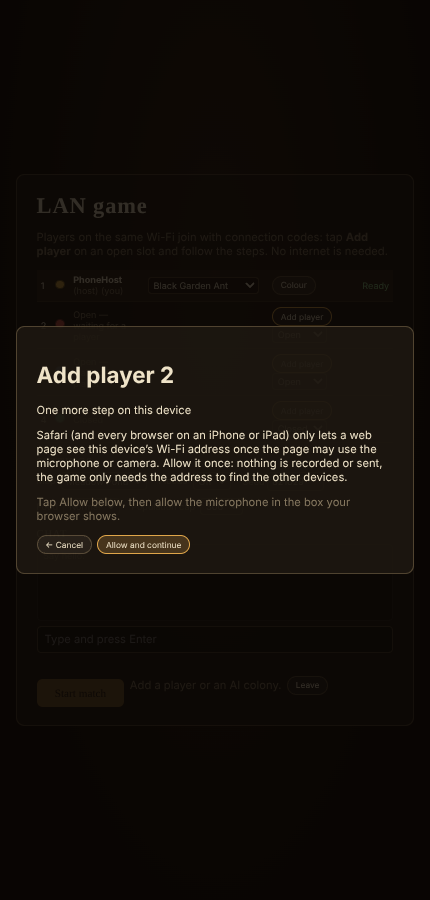

# Multiplayer and simulation architecture

Status: designed in Step 1 (2026-10-24). This is the design every later step follows. The implementation order and the flagged decisions are in CHANGE_PLAN.md §10.

Progress (all steps done; Step 2 verification in CHANGE_PLAN.md §10.3):
- **MP1, determinism groundwork.** `sim/dmath.ts`, `sim/snapshot.ts`, `tools/check-determinism.ts`, `src/dev/determinism.ts` with `tools/determinism.ts`, the browser page `?scene=determinism`, and the hidden state moved into `SimState`. See §2.1.
- **MP2, commands.** 12 command types (`sim/commands.ts`), applied at the tick boundary in (player, seq) order; single-player applies them at once, with pending feedback while one waits; replays are the command log.
- **MP3, spatial queries and shared flow fields.** One path field per destination hex, built incrementally from the nest grid's air log and capped (LRU 64); `enemiesNear` from the spatial hash.
- **MP4, LOD, presets and auto quality.**
- **MP5, simulation in a Web Worker** with structure-of-arrays frames and an exact main-thread replica (§3).
- **MP6, lockstep core** (§5) with headless tests for sync, desync, drop and rejoin, and steady pace at 150 ms.
- **MP7, front end**: title screen, lobby, PeerJS transport, in-match HUD, results (§6).
- **MP8, tools and deployment**: shared-memory frames, `_headers`, replays, `?stress=1`, `?netsim` (§7, §8).
- **Surrender** (added in Step 2 so a match can be finished on purpose): a command; the colony is out, the last queen standing wins.

Goals:
- 2–4 players, each with a colony, joining through an invite link.
- A steady 60 FPS with large colonies across several underground maps.
- Single-player runs the exact same simulation and command system as multiplayer, with zero input delay.

## 1. Overview

```
 main thread                                          sim worker
 ┌──────────────────────────────────────┐            ┌─────────────────────────────────┐
 │ input → UI → CommandQueue            │ commands → │ Lockstep scheduler              │
 │   instant local feedback (pending)   │            │   applies commands at tick T    │
 │ ViewWorld (read-only replica)        │ ← snapshot │ World (deterministic, 20 Hz)    │
 │   interpolates last two snapshots    │  (transfer)│   colonies, ants, creatures,    │
 │ renderers (only the viewed map)      │            │   all areas, pheromones, flows  │
 │ Net: Transport (host relay / peers)  │            │ hashes every 100 ticks          │
 └──────────────────────────────────────┘            └─────────────────────────────────┘
```

- **The worker owns the simulation.** It never sees the DOM, the camera or the frame rate.
- **The main thread never mutates the simulation.** Everything the player does becomes a *command*.
- **Networking runs on the main thread** (WebRTC is not available in workers in every browser). It collects every player's commands for a tick and hands them to the worker in one batch. The worker advances only when the batch for the next tick is complete.

## 2. Deterministic simulation (Part B)

| Rule | How |
|---|---|
| Fixed 20 Hz tick | `World.step()` always uses `TICK = 0.05`. The worker's tick count is driven by the lockstep scheduler, never by frame time. Fast-forward runs more ticks; it is disabled in multiplayer. |
| One seeded RNG | `core/rng.ts` (mulberry32) is already the only RNG in sim code. It is seeded from the match seed and its state is part of the snapshot. The brief suggests xoshiro128** or PCG; mulberry32 is just as deterministic, so it stays unless the user prefers a change. |
| No wall-clock or real-time APIs | `Math.random`, `Date`, `performance.now`, `setTimeout` and `requestAnimationFrame` are banned in `src/sim`, `src/world` and `src/core/rng.ts`. Enforced by `tools/check-determinism.ts`, which runs in the test suite (a lint-style scan). |
| Deterministic math | Doubles with basic IEEE operations only (`+ − × ÷`, `Math.sqrt`, `floor`/`round`/`abs`/`min`/`max`, `imul`), which are exactly rounded in every engine. `Math.sin`, `cos`, `atan2`, `hypot`, `exp` and `pow` are replaced by `sim/dmath.ts` (`dsin`, `dcos`, `datan2`, `dhypot`, `dexp`, `dpow`): range reduction plus polynomials written with basic operations only, so every browser gives bit-identical results. |
| Ordered iteration | Entities live in arrays ordered by id, created in id order and compacted stably. `Map`/`Set` iteration is insertion-ordered by spec and filled deterministically. Plain-object iteration (`Object.entries` on caste counts) uses insertion order, which is also deterministic. Sorts use stable `Array.prototype.sort` with total comparators. |
| No hidden state | Everything that carries over between ticks is in `SimState`, so snapshots are complete. The AI brains (now in `WeakMap`s) and nest intruders (now `World.intruders`) move into state. Caches that are pure functions of state (flow fields, spatial hashes, hex speeds) may stay outside it. |
| No reads of render or UI state | The simulation reads only `SimState` and command data. Per-player UI facts (who is "the player", reveal-all-areas, edge scrolling) move out of `SimState` or become host-set match settings. |
| Snapshot and hash | `sim/snapshot.ts` writes a canonical binary encoding of the whole state (no JSON float printing). `hashState()` is FNV-1a 64-bit over that byte stream. |

### 2.1 What is implemented (MP1)
- **`sim/dmath.ts`**
  - `dsin`, `dcos`, `datan`, `datan2`, `dexp`, `dlog` and `dpow` use fdlibm/musl range reduction and polynomials, written with basic IEEE operations only.
  - `dhypot` and `dhypot3` are built on the exactly rounded `Math.sqrt`; `sq(x)` replaces `x ** 2`.
  - A codemod replaced 290 calls in `src/sim` and `src/world`.
  - The results agree with V8's `Math` to within 1 ulp (2–3 ulp for `dpow`).
- **`tools/check-determinism.ts`** runs first in `npm test`. It is a lint-style scan of `src/sim`, `src/world` and `core/rng.ts`, after comments are stripped. It bans:
  - `Math.random`, `Date`, `performance`, timers and `crypto`;
  - the approximated `Math.*` functions and `**`;
  - `WeakMap`/`WeakSet`/`WeakRef`;
  - module-level `let`/`Map`/`Set` without a `// det-ok:` reason;
  - imports from render, UI, game, audio, dev and three.js;
  - `window`/`document`/`localStorage`/`navigator`.
- **Hidden state moved into the state:**
  - the AI build and forage planners → `Colony.aiBuild` and `Colony.aiForage`;
  - nest intruders → `Colony.intruders`;
  - the pheromone evaporation phase → derived from `s.tick`;
  - nest `hexTotal` and the raw `designated` raster → included in grid snapshots (and `hexTotal` in saves).
  - `hexSpeed` stays a cache: it is skipped by snapshots and reset on load.
- **Per-client facts moved out of the simulation:**
  - `revealAreas` is now `GameSession.revealAreas`;
  - `GameSession` takes its local colony id (the `local` constructor argument);
  - simulation messages carry `colony` and are shown only to that colony's player.
- **`sim/snapshot.ts`**
  - `encodeState(w)` is a canonical tagged binary encoding of `SimState` (minus the lazily serialized nest data), plus raw nest-grid arrays and pheromone fields. It writes numbers bit-exactly (−0 kept, NaN canonical) and interns strings.
  - `hashState(w)` is FNV-1a 64 over those bytes; `restoreWorld(bytes)` rebuilds a running World with systems registered and flow costs primed.
  - The 4-colony test map snapshots to about 1.1 MB. Encoding plus hashing takes about 11 ms (7.4 s across the 660 hashes of the 20-minute test).
- **Determinism test** (`npm run test:determinism -- <minutes>`). Same seed and scripted player orders: run A, run B (fresh, same process), and run C (restored from A's snapshot at the quarter mark), with hashes compared every 100 ticks.
  - **20 minutes of game time (24,000 ticks, 240 checkpoints, 4 AI colonies growing to 217 ants, two caves): all identical**, about 70 s per run.
  - `npm test` runs a 1-minute version.
  - `tests/browser/determinism.py` runs the same check in Chromium (`?scene=determinism&min=2`) and compares every checkpoint with Node: identical.
  - Firefox and Safari are not installed in the build container. Opening `?scene=determinism` on the deployed site in each browser and comparing the final hash is the cross-engine check (README).

## 3. Performance architecture (Part A)

- **Simulation in a Web Worker** (`src/worker/simWorker.ts`).
  - The worker posts a compact snapshot after each tick: ants, creatures, food, brood and projectiles in typed arrays (structure-of-arrays, previous and current pose for interpolation).
  - Slow-changing state (colonies, tiles, groups, markers, caves, settings) is sent only when its version changes.
  - Nest grid changes travel as digging diffs (changed hexes).
  - Buffers are **transferred** (zero-copy) and returned to a pool. `SharedArrayBuffer` double-buffering is used only when the page is cross-origin isolated, with transferables as the fallback, which works on GitHub Pages.
- **ViewWorld** (`src/game/viewWorld.ts`) is the main thread's read-only replica.
  - It exposes the same read API the renderers and UI use today (`s.ants`, `colony()`, `nestOf()`, `entrancesOf()` and so on), so rendering code changes little.
  - Entity view objects are pooled and refilled from the typed arrays, with no per-frame allocation.
- **Interpolation.** Rendering interpolates between the last two snapshots (`px → x`, as today), giving smooth motion at 60+ FPS from a 20 Hz simulation.
- **Data-oriented simulation.**
  - Hot loops allocate nothing (scratch buffers, pooled query results, no `filter`/`map` per tick).
  - Spatial hashes per map exist already.
  - Ants and creatures move to a **structure-of-arrays** store (`sim/ecs.ts`). See decision §10.4-1 for the order of work.
- **Flow fields per destination.**
  - Fields are shared per destination: per marker, per entrance set, per tile chamber, per queen, per cave cache. Ants steer directly over the last stretch to their own point.
  - Invalidation is incremental: a tile or dig change marks only the fields whose region it touches, and recomputation is spread across ticks (a fixed time budget per tick).
  - The profile shows flow fields at about 46 % of tick time today (docs/performance.md).
- **Pheromones** are typed arrays already. Evaporation becomes incremental: a slice of the grid each tick instead of the whole grid.
- **Off-screen areas** simulate fully (needed for correctness). Rendering work runs only for the viewed map.
- **Rendering.** Instanced ants are already one draw call per caste/LOD, with GPU leg/antenna/mandible animation and impostors. Still to add:
  - per-instance frustum culling buckets;
  - an **automatic quality** mode that steps the preset down when frame time stays above 18 ms.
- **WebAssembly (Rust)** is used only if a system still misses its budget after the steps above. It is kept deterministic: integer or fixed-point maths inside.

## 4. Command system (Part C)

Every player action is a command:

```
Command { tick: u32, player: u8, seq: u16, type: u8, ...params }
```

As built (`sim/commands.ts`; the id is the wire byte, and new types only ever get new ids so old replays still decode):

| Id | Type | Params |
|---|---|---|
| 1 | `placeMarker` | marker i (u8), space (u16), x, y (f32) |
| 2 | `removeMarker` | i |
| 3 | `assignGroup` | group id (u32), marker (−1..4) |
| 4 | `dig` | hex (u16), on |
| 5 | `buildTile` | hex, tile type, caste |
| 6, 7 | `markUpgrade` / `markDelete` | hex |
| 8 | `setAggression` | on/off |
| 9 | `recall` | (none) |
| 10 | `useAbility` | (none) |
| 11 | `setControl` | host only: colony, human or AI (drop / rejoin) |
| 12 | `surrender` | (none): the queen dies, the colony is out |

- **Binary encoding** (`DataView`): a few bytes each, batched per tick and player: `[tick u32][player u8][count u8]` then `[seq u16][type u8][params]` per command. Floats are quantized to f32 when issued, so the issuer applies exactly what the others decode.
- **Execution.** Commands are applied by `applyCommand(world, cmd)` at the *start* of their tick, in `(player, seq)` order. Each is validated (the player owns that colony, the marker index is in range, the hex is legal); invalid commands are ignored, deterministically on every client.
- **Single-player** uses the same queue with input delay 0: a command issued between ticks runs on the next tick.
- **Instant feedback** (main thread only, never sent to the simulation):
  - a placed marker appears at once with a "pending" shimmer;
  - tile ghosts appear;
  - group cards move in the panel;
  - a click sound plays.
  - The pending overlay clears when the command's tick has executed, or rolls back if the simulation rejected it.

## 5. Lockstep networking (Part D)

As built (`net/lockstep.ts`, `net/netGame.ts`, `net/transport.ts`):

- **Input delay.** A command issued at tick T is scheduled for T + D. D starts at 3 ticks (150 ms) and adapts between 2 and 8. The host suggests it from the two slowest one-way links plus 2 × jitter. No agreement is needed: each packet says which tick it is for, so a change of D only changes which tick new commands land on.
- **Tick packets.** Every client sends one packet per tick, even an empty one (`[u32 tick][u8 player][u8 count]{u16 seq, body}`). A client advances to tick N only when it holds every active player's packet for N.
- **Topology.** A star: guests send to the host, which relays to the others and checks that a packet's player matches the peer it came from.
- **Falling behind.**
  - The clock keeps up to 250 ms of debt, so a short stall is caught up after.
  - A client that is ahead slows a little rather than freezing.
  - After 3 s of waiting: "Waiting for <player>…", with a Drop button for the host.
  - After 30 s (120 s for a player still loading) the host drops the player: a host-only `setControl` command hands the colony to the AI from a given tick, on every client.
- **Transports.**
  - `LocalHub`: in-memory, with latency, for headless tests.
  - `BroadcastChannelTransport`: tabs on one machine (`?local=1`). It has no time-outs; a closing tab says goodbye on `pagehide`.
  - `PeerTransport`: PeerJS WebRTC data channels. The room code maps to the host's peer id (`ud-<room>`). ICE servers from `net/relay.ts`: Google STUN plus a TURN relay, `VITE_TURN_*` when set at build time (the Pages workflow passes the repository variables `TURN_URL` / `TURN_USER` / `TURN_PASS`), else the Open Relay Project's public static-auth server (`staticauth.openrelay.metered.ca`, UDP 80, TCP 443, TLS 443) with TURN REST API credentials made in the browser from Metered's published shared secret (user `<expiry>:ud`, password base64 HMAC-SHA1, valid 24 h). PeerJS's own free TURN servers were shut down in 2023. A guest gives up after 30 s, or at once when ICE fails, with advice (VPN, Check connection, LAN). An ICE `disconnected` gets 8 s to recover before the player counts as gone.
  - `ManualRtcTransport` (`net/lanTransport.ts`): LAN play, WebRTC data channels set up by hand with connection codes and `iceServers: []` (section 6.1).
  - `NetSimTransport`: wraps any transport with latency, jitter and loss (`?netsim=lat,jit,loss`).
  - A WebSocket relay later only needs a new `Transport`.
- **Desync detection.**
  - Every 100 ticks each client sends `hashState()` and the hashes are compared.
  - On a mismatch every client stops and shows "Desync detected", with a downloadable report: the snapshot (binary), the recent packets, the hashes and the build id.
  - The game never continues out of step.
- **Rejoin.** A player who reopens the invite link is recognised by their token. The host sends a snapshot taken at a tick boundary, the packets since and the player states; the client restores (`NetGame.fromResync`), fast-forwards, then plays in lockstep again. A client that finds itself dropped reloads and rejoins.

## 6. Lobby and invite links (Part E)

- The main menu adds **Multiplayer**, with **Create Game** and **Join Game**.
- **Create Game** makes a room code and shows `https://<site>/?room=ABC123` with **Copy Link**. Opening that link goes straight to the lobby.
- **Lobby.**
  - Four slots, each with name, species, colony colour, ping and ready status.
  - Empty slots can be Open, Closed or AI.
  - The host picks map, seed, starting food and population cap; game speed is fixed at 1×.
  - Start is enabled when everyone is ready.
- **Match setup** is generated from the shared seed:
  - a surface with 2–4 fairly spaced spawns;
  - one home nest per colony, plus neutral lairs.
  - Each player sees their own nest as area 1 and the others as enemy areas (this already works: `areasFor(world, colony)`).
- **In match.** A multiplayer match cannot be paused (user rule) and runs at 1×. Opening a menu or photo mode does not stop it.
- **Surrender.** In the menu, two clicks. The colony is out on every client; that player can keep watching.
- **End.** The last queen standing wins, followed by a results screen with per-colony stats. Text chat (Enter), with mute.
- Sandbox options (revealing every area) are single-player only.

### 6.1 LAN play: connection codes, no servers (2026-10-26)

For 2–4 devices on one Wi-Fi or network with no internet, no PeerJS, no STUN and no TURN. Multiplayer → **LAN**.

**The exchange** (one per joining player; star topology as online):
1. The host taps **Host LAN game**, then **Add player** on an open slot. The game makes an offer, waits for ICE gathering (at most 3 s, host candidates only) and shows **host code #N**: a QR code, the text with **Copy**, and **Show larger** for scanning across a desk.
2. The player taps **Join LAN game** and scans the QR code (**Scan QR code**: `BarcodeDetector`, else the bundled jsQR; the camera is asked for only then) or pastes the text. Their device shows a **reply code**.
3. The host scans or pastes the reply. The data channel opens (0.4 s in the tests) and the player appears in that slot with name, species, colour and ping. Everything else in the lobby is as online.

**Codes** (`net/lanCode.ts`): `UD1H-` / `UD1R-` + URL-safe base64 of [mode][u32 session][u8 slot][u32 created][body][CRC-16]. The compact body keeps only the ICE username fragment and password, the DTLS fingerprint and role, the data-channel mid, SCTP port and maximum message size, and the UDP host candidates as raw address bytes; the other side rebuilds a minimal data-channel SDP. 128 characters with IPv4 candidates, about 170 with mDNS names. A description the compact form cannot represent is sent stripped of unneeded lines and deflated (or plain). Codes expire after 5 minutes (2 minutes of clock difference allowed) and work once. Decoding validates and limits everything (text 3,000 characters, payload 2,200 bytes, inflated SDP 8 KB, 16 candidates).

**Messages:** "not a connection code", "damaged or incomplete" (CRC), "from a different version", "this is a host code: it goes to the joining player" / "this is a reply code: it goes to the host", "expired", "already used", and after 15 s without a connection the network advice: same Wi-Fi; guest networks and client (AP) isolation block devices from seeing each other; VPNs can too; try a phone hotspot.

**Mid-match drops:** the usual "Waiting for…" flow runs (AI after 30 s). The host taps **Players → Reconnect player N** (or **Reconnect with a new code** on the banner) for a new host code; the dropped player taps **Rejoin with a new code**, which reloads that tab into the rejoin screen with its token; after the exchange the host sends the snapshot and the packets since, as for an online rejoin. If the host leaves, everyone sees "The host ended the match".

**Where it works:** the game's website (GitHub Pages, https://chibisc.github.io/WIP/) or any ordinary page that serves `dist/`. Inside the Claude artifact viewer the page has no `RTCPeerConnection` at all (its frame blocks WebRTC), so neither LAN nor online play can work there; the Multiplayer menu says so and links to the website (Local tabs still work).

**Camera:** some embedding pages (such as the published artifact's frame) do not let the game use the camera; Scan QR code then says so and the code is pasted instead. A phone's own camera app can also read the QR code as text to copy.

**No outside servers:** `LAN_RTC_CONFIG` is a frozen `{ iceServers: [] }`; entering LAN mode also wraps `RTCPeerConnection` to log any connection made with ICE servers. The QR encoder and decoder are npm packages compiled into the build. The page must be loaded first (the artifact, or a local copy of `dist/` served on the network); then LAN play needs no internet. Google Fonts are cosmetic.

**Browsers:** Chrome, Edge and Firefox name local addresses with mDNS (`<uuid>.local`); most home networks resolve those. If a network does not, the connection fails with the advice above; granting microphone or camera access makes the browser offer plain IPs instead (Check connection → Allow on the LAN tab does that). WebKit (Safari, and every browser on iPhone and iPad) can hide the page's own addresses entirely until it may use the microphone or camera: Host LAN game's Add player and Join LAN game first probe for an address (`lanNeedsPermission`, a quick offer with no ICE servers), and when there is none on WebKit show "One more step on this device" with **Allow and continue**, which asks for the microphone (camera as a fallback), stops the tracks at once and carries on. A code is never made from a description with no address: that is refused with the reason (WebKit or network tips). Tested here in Chromium (plain IP candidates; this container has no mDNS resolver): two and four players, wrong codes, a reconnect. Not yet tried on physical devices or across browsers.

### 6.2 When players cannot connect: Check connection (2026-10-26)

**Multiplayer → Check connection** (Online and LAN tabs; `ui/netCheckView.ts`, `net/netCheck.ts`) gathers ICE candidates once and sorts them (`sortCandidates`): `host` (plain IP or mDNS `.local`), `srflx`/`prflx` (an internet address via STUN) and `relay` (the TURN relay answered). Online mode also fetches `https://0.peerjs.com/peerjs/id` to see that the matchmaking server answers. Each result is a plain sentence with ✓/✗, plus VPN advice when anything is blocked. LAN mode uses no ICE servers (`checkRoutes([])`), so it contacts nothing outside the network; when the address is hidden or only a `.local` name, it offers **Allow and check again**.

The usual causes, in order: a VPN on either device (blocks local devices and, with "WebRTC leak protection", all non-proxied UDP); guest networks and client isolation (LAN); networks where only the relay gets through (phone data, school or work).



Tests: `tests/lan.ts` (relay credentials against a known HMAC, the default relay URLs, candidate sorting); `tests/browser/net_check.py` (LAN and online checks; an iPhone user agent with a page that hides its addresses until `getUserMedia`, as WebKit does: the check offers Allow, the host's Add player and the join screen ask first, and a normal browser joins the iPhone host). The relay itself cannot be reached from the test sandbox: check it on the live site.

## 7. Testing tools (Part F)

| Tool | What it does |
|---|---|
| **F3 debug overlay** | FPS, frame time, simulation tick time, tick, ping per player, input delay, pending commands, last hash, desync status |
| Local multiplayer | Up to 4 tabs with `BroadcastChannelTransport` (`?room=…&local=1`) |
| LAN test | `tests/browser/lan.py`: real WebRTC between Chromium pages with no ICE servers, through the menus (two and four players, wrong codes, a reconnect, no requests to outside servers); `tests/lan.ts` checks codes and framing in Node |
| Network simulator | Dev setting for latency, jitter and loss |
| Determinism test | `tools/determinism.ts` runs a seed plus scripted commands twice in Node and once from a snapshot, comparing hashes every 100 ticks for 20 minutes of game time. `?scene=determinism` runs the same in a browser (tested in Chromium; open it in Firefox and Safari on the deployed site to compare engines). |
| Stress test | `tools/stress.ts` (headless) and `?stress=1` (in browser, logs FPS and tick stats) |
| Replays | Seed plus command list saved as a `.udreplay` file and played back; also the main desync-debugging tool |

## 8. Deployment (Part G)

- `npx vite build` produces a static site: GitHub Pages, Netlify or itch.io.
- **Netlify:** `public/_headers` sets `Cross-Origin-Opener-Policy: same-origin` and `Cross-Origin-Embedder-Policy: credentialless` to enable `SharedArrayBuffer` (credentialless still lets PeerJS and fonts load). The dev server sends the same.
- **GitHub Pages:** no custom headers, so the transferable fallback is used.
- **Invite links** need the deployed site. A local dev server only works for players on the same machine or network.

## 9. Non-determinism audit (Step 1.4, 2026-10-24)

Found in the current code. Every item is fixed in the architecture steps.

1. **Frame-rate-driven ticks.** `core/loop.ts` decides how many ticks to run from real frame time and drops ticks when it falls behind (`maxTicksPerFrame`, then `acc = 0`). Lockstep must drive ticks; frame time may only drive rendering.
2. **`Math.random()`** appears nowhere in the simulation. One use in `main.ts` picks a random seed when none is given; that is fine for single-player, but the multiplayer seed comes from the host. Render, UI and particle effects use it freely, which is allowed.
3. **`Date.now()` / `performance.now()`**: none in the simulation (only `core/loop.ts`, the shot-mode helper in `main.ts`, and dev and render code).
4. **Transcendental maths** in simulation code, about 260 calls:

   | File | Calls |
   |---|---|
   | `sim/creatures/creatureAI.ts` | 63 (sin 21, cos 20, hypot 13, atan2 9) |
   | `sim/antAI.ts` | 35 |
   | `sim/combat.ts` | 28 |
   | `sim/movement.ts` | 25 |
   | `sim/jobs.ts` | 19 |
   | `sim/food.ts` | 13 |
   | `world/terrain.ts` | 11 (also `exp`, `pow`; terrain generation decides passability) |
   | `sim/mapGen.ts` | 10 |
   | `sim/colony.ts` | 5 |
   | `world/nestGrid.ts` | 4 |
   | `sim/colonyAI.ts` | 3 |
   | `sim/speciesAI.ts` | 3 |
   | `sim/pheromones.ts` | 2 (`pow`) |
   | `sim/tiles.ts` | 2 |
   | `sim/areas.ts` | 2 |
   | `sim/flow.ts` | 1 |

   All of them move to `dmath`.
5. **Hidden state outside `SimState`.** These are not saved or hashed, so a rejoining client would diverge:
   - `colonyAI.ts`: `brains` and `forageBrains` (`WeakMap<Colony,…>`: think timers, mixes, forage target, the queen-out flag);
   - `World.intruders` (refreshed every 20 ticks and read in between);
   - `Colony.hexSpeed`, which is a pure cache and fine.
6. **The simulation reads per-client facts.**
   - `World.playerColony()` (first colony with `player`), `c.player` in messages and stat multipliers, and `settings.revealAreas` (a viewer setting stored in the simulation).
   - In multiplayer `player` becomes "human-controlled"; *which* human is local is a client fact kept outside the simulation.
7. **The UI mutates the simulation directly**, bypassing any queue:
   - `game/session.ts`: dig paint, tile place/cancel, upgrade/delete marks, marker place/remove, aggression, recall, selected-tile upgrade/remove;
   - `ui/markerPanel.ts`: group drag, recall, ability;
   - `ui/menus.ts`: the reveal setting;
   - dev hooks `?layout`, `?battle`, `?chamber` (fine as match setup, but they must run before tick 0 on every client).
8. **Events are drained by listeners on the main thread.** No listener mutates the simulation today, and that becomes an enforced rule (the worker boundary makes it impossible).
9. **Iteration order** is deterministic today: arrays ordered by id, insertion-ordered `Map`/`Set`/object keys filled deterministically, stable sorts. This holds as long as no `Set` is filled from an unordered source. The rule is kept in review.
10. **JSON as a hash source.** Float-to-text conversion is deterministic in modern engines but slow (2 MB, 50 ms). Hashing uses the binary snapshot.
11. **Float32 caches.** Flow fields and pheromones are `Float32Array`s. Rounding to float32 is IEEE-exact everywhere, so they are deterministic.
